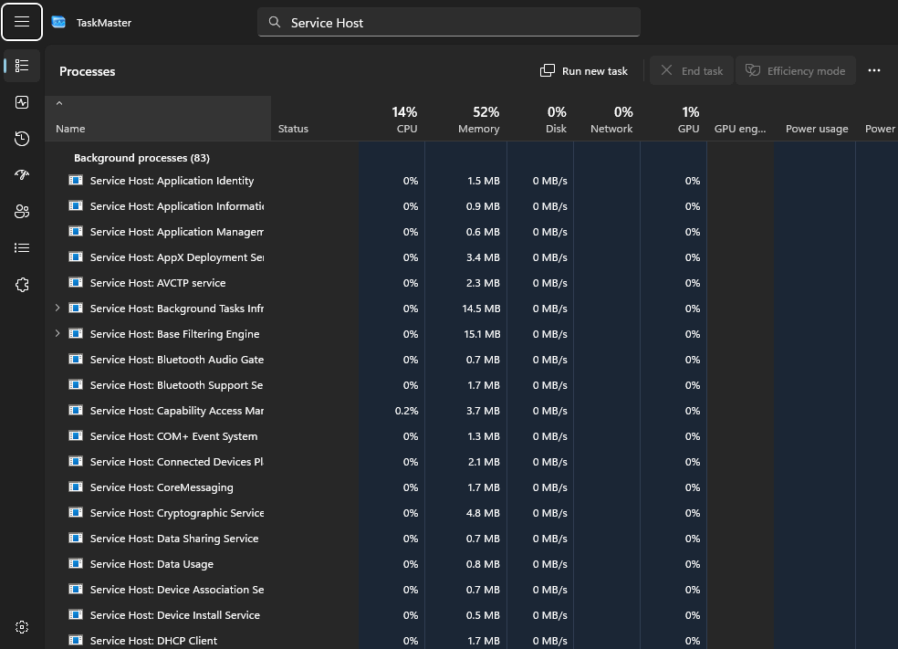
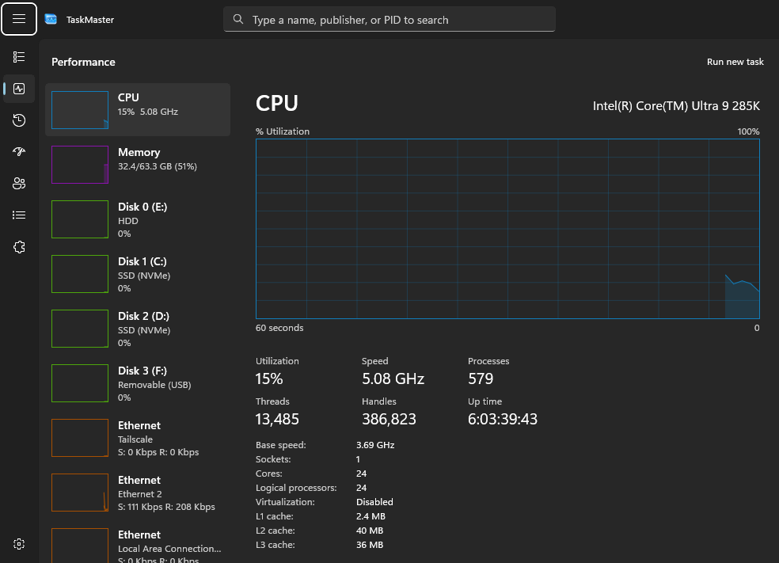

<p align="center">
  
</p>

<h1 align="center">TaskMaster</h1>

<p align="center">
  
  
  
  <a href="../../releases/latest"></a>
</p>

**TaskMaster is the Windows 11 Task Manager, rebuilt to open instantly.** Same pages, same columns, same look, but the window appears straight away and the numbers fill in behind it, so it never stalls your desktop, even with hundreds of processes and a busy GPU.

<p align="center">
  
  
</p>

## What you get

- **Every page Task Manager has:** Processes, Performance, App history, Startup apps, Users, Details and Services, with the right-click menus you know (end task, efficiency mode, open file location and more).
- **Opens instantly:** the window comes first and data second. One cheap system call per update instead of hundreds of performance counters.
- **Replace Windows Task Manager (optional):** Ctrl+Alt+Del, the taskbar menu, Start and anything else that opens Task Manager opens TaskMaster instead. Ctrl+Shift+Esc has its own switch, and turning it off gives everything back to Windows.
- **See-through window:** Mica like Task Manager, or Acrylic and Glass with an adjustable tint.
- **Your way:** window scale, font, update speed, start page, always on top, and a custom shortcut (left and right keys count separately).
- **Tray and start with Windows (optional):** keep it running by the clock, ready to open the moment you need it.
- **Updates itself:** checks for new versions in the background. Nothing installs until you press **Update**, and it reopens on the page you were on. Every update is signature-checked before it's installed, and one that fails to start is rolled back.

## Install

1. Download `TaskMaster-<version>.zip` from the [latest release](../../releases/latest).
2. Unzip it into a folder of its own, for example `C:\Apps\TaskMaster`.
3. Run `TaskMaster.exe`. It asks for administrator rights like Task Manager does; say no and it still runs, with a few columns left blank.

Settings live in **Settings** (bottom left). To have Ctrl+Alt+Del and the taskbar open TaskMaster, turn on **Replace Windows Task Manager** there.

## Good to know

- **Windows warnings.** TaskMaster isn't code-signed yet, so SmartScreen may warn you the first time (choose **More info → Run anyway**). The full source is here.
- **Uninstall.** In Settings, turn off **Replace Windows Task Manager** and **Start with Windows**, then delete the folder and `%LOCALAPPDATA%\TaskManager`.
- **Logs.** Errors go to `%LOCALAPPDATA%\TaskManager\logs\app.log`. If TaskMaster ever closes unexpectedly, it says so next time and offers the log.

## Building

Needs the .NET 10 SDK on Windows 11.

```
dotnet build src/TaskManager/TaskManager.csproj -c Release
```

Releases are made with `tools/release.py`, which publishes, zips and signs the build with the release key (not in this repository).

## Feedback

Found a bug or have an idea? [Open an issue](../../issues). Bug reports, feature ideas and "Task Manager does X, TaskMaster doesn't" are all welcome.

---

GPL-3.0. Made with AI assistance.
